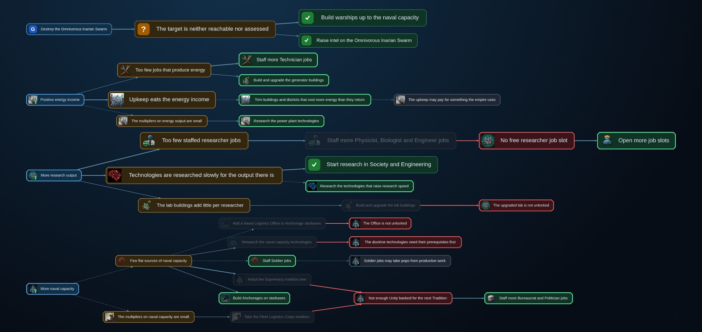
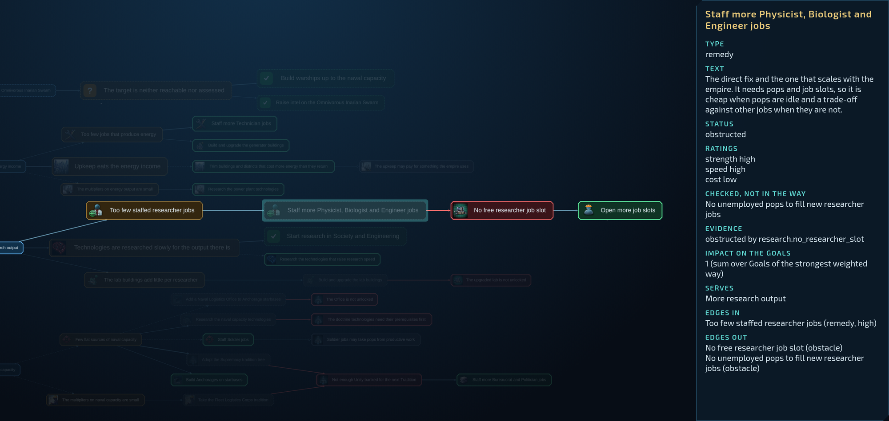
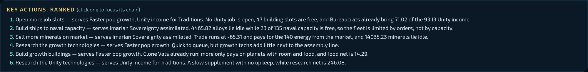
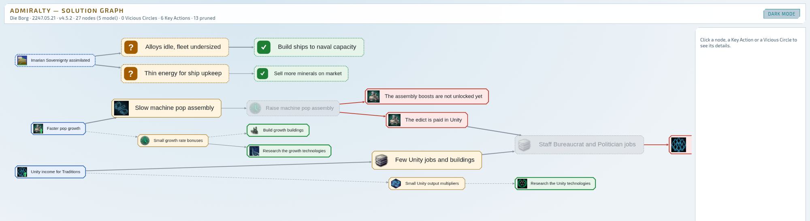

# Admiralty

**Learn to play Stellaris better, from your own save files.**

Admiralty is a [Claude Code](https://claude.com/claude-code) plugin that reads your Stellaris saves
and works out why your empire is stuck, what is blocking the fix, and what to do first. It can do
that for you, or teach you to see it yourself. No game mod required, and multiplayer stays
checksum-safe.



## Three ways to use it

| | You want | What you get |
| --- | --- | --- |
| **Ops** (Consulting mode) | The best result right now | A Briefing: the Situation, Goals, a Solution Graph and a ranked Action Plan |
| **Academy** (Coaching mode) | To become a stronger player, even at the cost of this Campaign | A Coach who asks questions instead of giving answers, and remembers what you have mastered |
| **Debrief** (both modes) | To understand how you got here | A look back over the last session or the whole Campaign: its epochs, what worked, what to learn |

## Installation

### Requirements

- **Linux** with Stellaris from Steam. Windows and macOS are not supported yet.
- **Stellaris 4.5.2** (Cygnus), vanilla or with cosmetic mods only. See [Limits](#limits).
- **[Claude Code](https://claude.com/claude-code)**, a current version.
- **[uv](https://docs.astral.sh/uv/getting-started/installation/)**. It fetches Python 3.14 or later
  by itself if you do not have it.

### Install the plugin

```sh
claude plugin marketplace add juliantrude/admiralty
claude plugin install admiralty@admiralty
```

Then build it once. This compiles the save parser and takes a few minutes the first time; a Rust
toolchain is downloaded automatically if you have none. Skipping this step works too, but your first
session may then start before the build is done.

```sh
uv sync --project ~/.claude/plugins/cache/admiralty/admiralty/*/
```

If Admiralty cannot find your game, set these before you start Claude Code:

```sh
export ADMIRALTY_GAME_DIR=/path/to/steamapps/common/Stellaris
export ADMIRALTY_USER_DIR="/path/to/Paradox Interactive/Stellaris"
```

### Set up a Campaign

Each Campaign gets its own folder. Claude Code runs there, and everything about the Campaign stays
there.

```sh
mkdir -p ~/stellaris/my-campaign && cd ~/stellaris/my-campaign
claude
```

```text
/admiralty:setup
```

A short interview asks which Campaign this is, which empire is yours, who plays along (ally or
rival), the mode, the knowledge setting and whether you want the save service. To change an answer
later, run the setup again.

## Usage

Save your game, then talk to Claude in that folder. Admiralty answers in the language you write in.
From the next session on, the folder's `CLAUDE.md` loads the right mode by itself.

### Ops: tell me what to do

Choose **Consulting** in the setup, then ask anything:

```text
Where do I stand, and what should I do first?
I want to wipe out my neighbour. What is in the way?
```

You get a short written Briefing, and the Solution Graph opens in your browser. There is one current
Briefing per Campaign. New feedback or a new Goal replaces it, and the old one moves to
`briefings/history/`.

### Academy: teach me to see it

Choose **Coaching** in the setup, then start playing and talking:

```text
Next topic.
Why is my energy going down?
I give up, just tell me.
```

- **One question at a time.** The Coach opens with what matters most in your newest save and asks
  for your read of it. Crises come first.
- **Hint Ladder.** After a failed attempt, the help goes one step up: question, hint, partial answer,
  full explanation.
- **Escape Hatch.** Ask for the answer and you always get it. It is recorded as such, because help
  does not count as your own achievement.
- **Predictions.** Before a major decision, you say what you expect it to achieve. A later save
  checks you.
- **Rendezvous.** You agree on an in-game date, play until then, and the next Drill starts by
  reviewing what happened.
- **Player Model.** Your mastery of each concept, from New to Create, based only on what you
  observably did. It follows you across Campaigns, and you can ask the Coach what it knows about you.

The Coach uses the Solution Graph internally and never shows it.

### Debrief: what happened?

Works in both modes:

```text
How did the last session go?
Go through the whole Campaign. What should I learn from it?
```

Debrief divides the Campaign into epochs using the game's own Timeline and your archived saves, then
says what went well and what went badly. In a Coaching Campaign, your own assessment comes first,
followed by your Predictions and what moved in your Player Model.

### Two settings that apply to every mode

| Setting | Options | Meaning |
| --- | --- | --- |
| Mode | `consulting`, `coaching` | Never switches on its own. Run the setup again to change it. |
| Knowledge | `fair_play`, `god_mode` | **Fair Play** states only what your empire can see in the game. **God Mode** may use anything in the save, including what you cannot see. |

## The Solution Graph

The graph runs left to right, from what you want to what you can do about it.

- **Goals** (blue) are what you want.
- **Causes** (amber) explain why a Goal is not met.
- **Remedies** (green) address a Cause. A bright green border means you can do it now. Greyed out
  means something is in the way.
- **Obstacles** (red) are what is in the way, and they get Remedies of their own. A grey Obstacle
  could not be checked against numbers, so you judge it yourself.

Bigger nodes matter more, and thicker links explain more of the problem. A coloured dashed border
marks a node the model added for this situation, beyond the curated graph.

Click a node to focus its chain and read why it is there. Here, more researchers would help, but
there is no free job slot, so the first step is really "Open more job slots":



Below the graph, the Key Actions are ranked by code, not by the model, on how many Goals they serve,
how strongly, how fast and at what cost. Each one gives the numbers behind it.



The page works offline. Move with W, A, S, D or by dragging, zoom with the wheel, and switch between
dark and light:



## What else it does

- **Checks its own claims.** Answers are blocked and rewritten when a number, date or name in them
  does not appear in the game data. This is the Unverified Claim check.
- **Separates code from judgement.** Code extracts the numbers, walks the graph and ranks the actions.
  The model reads the Situation, chooses the Goals and explains.
- **Plans routes.** It finds the ways to a target empire or system, with the empires you would cross
  and their attitude towards you.
- **Handles multiplayer.** It maps player names to empires and tracks friends as allies or rivals.
- **Keeps a history.** Each save it reads is archived as a compact extract, so Debrief can still look
  back after the game has overwritten your autosaves.

### Save service

The optional save service is a systemd user unit that copies every new save while the game runs, so
Debrief keeps the autosaves too. If no new save arrives for 20 minutes, it sends a desktop reminder.
The setup offers to install it. `save_reminder_minutes` in `campaign.yaml` changes the wait, and `0`
turns the reminder off. Admiralty never changes your game settings.

## Your data

Everything stays on your machine: nothing Admiralty produces is published anywhere. The graph page is
served from `127.0.0.1` only and loads nothing from the internet. Claude Code does send your
conversation and the tool results to its model provider, as it does in any session. Those can
include empire names and multiplayer player names from your saves.

| Where | What |
| --- | --- |
| Your Campaign folder | `campaign.yaml`, `archive/`, `saves/`, `briefings/`, `debrief/`, `academy/`, `predictions/`, `.admiralty/` |
| `~/.local/share/admiralty/` | Your Player Model, across Campaigns (`ADMIRALTY_DATA_DIR` moves it) |

## Limits

- **Only game version 4.5.2.** The mechanics are curated per game version, and there is no silent
  fallback: for a save from another version, Briefings and Drills stop with an error rather than
  give advice that may be wrong.
- **Non-cosmetic mods** change the game's rules, so you get a warning before any advice.
- **The advice is only as fresh as your save.** Admiralty does not watch the running game, and it
  tells you when the newest save is old.
- **No "good for 2260" comparisons yet.** The Benchmarks are an unreviewed draft, and no Briefing
  uses them.
- **Early software.** Admiralty has mostly been tested by one player. Its version number follows the
  Stellaris version it supports, so it says nothing about maturity.

## Development

```sh
git clone https://github.com/juliantrude/admiralty.git
cd admiralty
uv sync
uv run pytest
uv run ruff check . && uv run ruff format --check .
```

Tests that need reference saves or Chromium skip when those are missing. The reference saves contain
other players' names and stay out of the repository. To run your clone as the plugin, use
`claude --plugin-dir /path/to/admiralty`.

- [GLOSSARY.md](GLOSSARY.md): the domain language
- [docs/build-plan.md](docs/build-plan.md): the v1 plan and architecture
- [docs/adr/](docs/adr/): architecture decisions

The project was called Hliðskjálf at first, and older design records keep that name. Some internal
notes under `docs/` are in German.

## Legal

The code is under the [MIT License](LICENSE). The libraries and the font in `engine/vendor/` keep
their own licenses, which sit next to them.

Admiralty is a non-commercial fan project with no connection to Paradox Interactive. Stellaris and
its content belong to Paradox Interactive. Game names and values under `knowledge/` come from the
game files, and the MIT License does not cover them. The repository holds no game image files: the
graph page takes its icons from your own installation. The screenshots above show such icons.

Save parsing uses the `rust_parser` from
[stellaris-dashboard](https://github.com/eliasdoehne/stellaris-dashboard).
